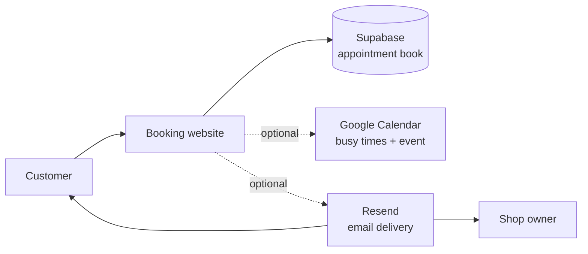
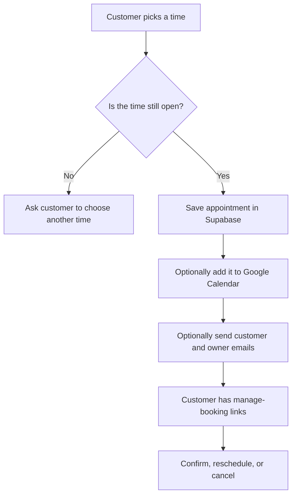
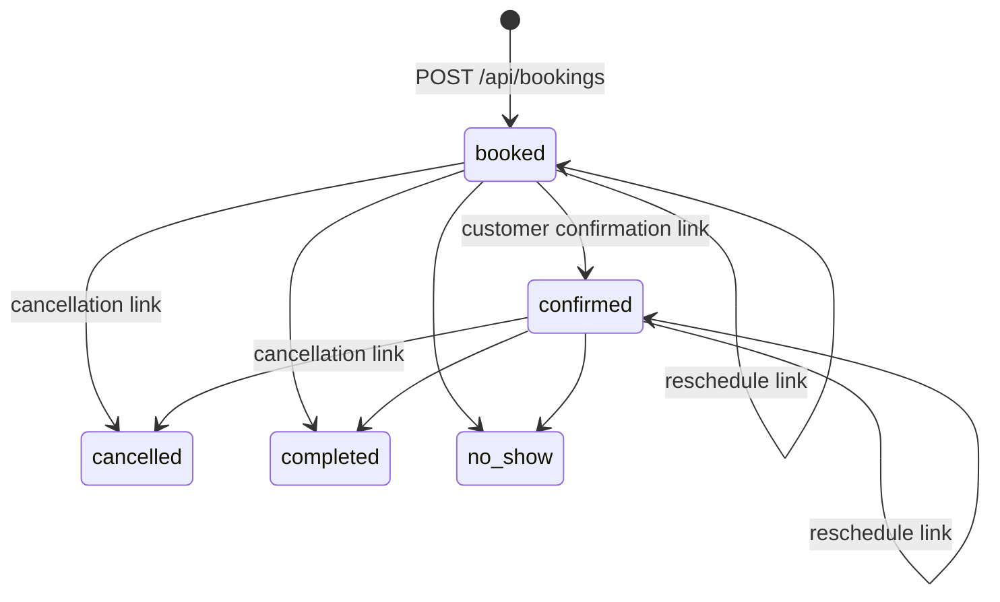

# 35th Tonsorial Barbershop

The website for 35th Tonsorial Barbershop: customers can see open appointments, book a service, and manage their booking. It is built so the shop can run its appointment book online without manually checking every request.

> **Plain-English analogy:** Think of this project as the shop's digital front desk. The website takes the customer's request, Supabase writes it into the appointment book, Google Calendar can mark off times that are already busy, and Resend can deliver the confirmation email.

## Human guide — running the shop website

### What the website does

- Shows the shop, services, prices, reviews, FAQ, hours, and location.
- Lets a customer choose a service, barber preference, date, and available time.
- Prevents two customers from reserving the same time.
- Sends a confirmation email and optional reminders.
- Gives customers links to confirm, reschedule, or cancel their appointment.
- Can create and update Google Calendar events automatically.

### The three places you will usually change

| If you want to change… | Go here | Think of it as… |
| --- | --- | --- |
| Shop name, contact details, team, services, prices, hours, or FAQ text | **lib/config.ts** | The shop's master information card. Change it once and the website uses it throughout. |
| Passwords, connection keys, email settings, and calendar settings | **.env.local** | The locked staff-only drawer. Never share or publish this file. |
| Database tables | **supabase/schema.sql** | The blueprint for the appointment book. Apply it once when setting up Supabase. |

### A booking, in everyday terms

The database is the final authority. Even if two people click the same slot at nearly the same moment, it only accepts one booking. It works like a barber putting one name in one line of a paper appointment book: once the line is filled, nobody else can claim it.

### Start it on your computer

You need Node.js 18.17 or newer and npm. First install the project packages:

    npm install

Create your private settings file:

    Copy-Item .env.example .env.local

Fill in the three required Supabase values in **.env.local**, then run the SQL in **supabase/schema.sql** inside **Supabase → SQL Editor**.

    NEXT_PUBLIC_SUPABASE_URL=
    NEXT_PUBLIC_SUPABASE_ANON_KEY=
    SUPABASE_SERVICE_ROLE_KEY=

Start the website:

    npm run dev

Then open [http://localhost:3000](http://localhost:3000).

### Optional extras

| Extra | Why you might use it | What to do |
| --- | --- | --- |
| Google Calendar | Stop calendar conflicts from appearing as bookable and add bookings to a calendar. | Set the Google variables and **BOOKING_CALENDAR_ID**, then run **npm run google-token** to create the refresh token. **SCHOOL_CALENDAR_ID**, **WORK_CALENDAR_ID**, and **PERSONAL_CALENDAR_ID** only block availability. |
| Resend | Send booking, change, cancellation, and reminder emails. | Set **RESEND_API_KEY**, **FROM_EMAIL**, and optionally **OWNER_NOTIFICATION_EMAIL**. |
| Reminders | Email customers 24 hours, 2 hours, and 1 hour before their appointment. | Schedule a secure POST request to **/api/cron/reminders** with the authorization header Bearer + your **CRON_SECRET**. |

**Important:** An appointment can still be saved when Google Calendar or email are not configured. Supabase is the one required piece—the appointment book must exist before the front desk can take appointments.

### Before publishing changes

    npm run lint
    npm test
    npm run build

Do not commit **.env.local**, the Supabase service-role key, your Google client secret, refresh token, or Resend key. Treat them like keys to the shop.

## AI / developer guide — maintaining the system

### Goal and boundaries

Maintain a Next.js 16 booking site for a Chicago barbershop. Preserve the existing booking behavior unless the request explicitly changes it. Before editing application code, read the relevant current Next.js documentation in **node_modules/next/dist/docs/**; this project uses a version with breaking changes from older Next.js conventions.

### Architecture map

    Browser UI
    ├─ app/page.tsx + components/*        Marketing page and booking form
    ├─ GET /api/availability              Returns bookable time slots
    └─ POST /api/bookings                 Validates and creates a booking

    Server-side booking services (lib/*)
    ├─ config.ts                          Business details, hours, services, copy
    ├─ availability.ts / open-slots.ts    Slot generation and conflict filtering
    ├─ validation.ts / phone.ts           Input validation and phone normalization
    ├─ supabase.ts                        Server-side database client
    ├─ google-calendar.ts                 Optional calendar synchronization
    └─ notifications.ts / email.ts        Optional emails and owner alerts

    Persistent and external systems
    ├─ Supabase                           Source of truth for bookings
    ├─ Google Calendar                    Optional event + availability sync
    └─ Resend                             Optional email provider

### Operational rules that must remain true

1. **No double bookings.** Check the slot before inserting, but rely on the **one_booking_per_slot** partial unique index in Supabase as the final guard.
2. **Supabase is required; integrations are best-effort.** A calendar or email failure must not undo a successfully stored appointment.
3. **Secrets stay server-side.** Never expose the service role, calendar credentials, mail credentials, or cron secret to client code.
4. **Use the configured timezone.** Booking logic uses America/Chicago by default; display and calculation must respect the configured business timezone.
5. **Manage links are safe to repeat.** Confirming or cancelling a booking twice should not create duplicate side effects.
6. **Calendar roles differ.** The booking calendar receives events; school, work, and personal calendars only make overlapping times unavailable.

### Booking lifecycle

### Key files and safe customization points

| Area | Primary file(s) | Notes |
| --- | --- | --- |
| Business details and availability rules | **lib/config.ts** | Preferred location for hours, services, staff, copy, and prices. Keep BUSINESS_TIMEZONE aligned with config.timezone. |
| Booking API | **app/api/bookings/route.ts** | Validates input, checks availability, inserts the row, then runs calendar/email work without blocking the response. |
| Availability | **lib/availability.ts**, **lib/open-slots.ts**, **app/api/availability/route.ts** | Keep slot calculation pure where possible; account for calendar, database, notice-period, and advance-window constraints. |
| Customer actions | **app/confirmed/[token]/page.tsx**, **app/cancel/[token]/page.tsx**, **app/api/bookings/[token]/** | Tokens locate appointments for confirmation, rescheduling, and cancellation. |
| Emails | **emails/**, **lib/notifications.ts**, **lib/email.ts** | Treat email sending as optional and non-fatal. |
| Reminders | **app/api/cron/reminders/route.ts** | Requires bearer authentication using CRON_SECRET; stamps a reminder before sending to avoid duplicates. |
| Database | **supabase/schema.sql** | Update deliberately and use migrations for deployed environments. |

### Environment reference

Use **.env.example** as the source of truth.

| Group | Variables | Required |
| --- | --- | --- |
| Appointment book | NEXT_PUBLIC_SUPABASE_URL, NEXT_PUBLIC_SUPABASE_ANON_KEY, SUPABASE_SERVICE_ROLE_KEY | Yes |
| Site/runtime | NEXT_PUBLIC_SITE_URL, BUSINESS_TIMEZONE, TRAINER_PHONE, CRON_SECRET | Set appropriately for deployment; cron needs CRON_SECRET. |
| Calendar | GOOGLE_CLIENT_ID, GOOGLE_CLIENT_SECRET, GOOGLE_REFRESH_TOKEN, BOOKING_CALENDAR_ID, SCHOOL_CALENDAR_ID, WORK_CALENDAR_ID, PERSONAL_CALENDAR_ID | Optional |
| Email | RESEND_API_KEY, FROM_EMAIL, OWNER_NOTIFICATION_EMAIL | Optional |

### Commands

| Command | Purpose |
| --- | --- |
| **npm run dev** | Run the local development server. |
| **npm run build** | Create a production build. |
| **npm start** | Serve a completed production build. |
| **npm run lint** | Run ESLint. |
| **npm test** | Run the availability, calendar-file, and phone tests. |
| **npm run google-token** | Start the Google OAuth helper that prints a refresh token. |

### Change checklist for an AI or developer

1. Read the closest implementation and its tests before editing.
2. Use **lib/config.ts** for business-content changes instead of scattering constants through UI files.
3. Never weaken database uniqueness, server-side validation, token behavior, or cron authentication without an explicit replacement.
4. Add or update focused tests for booking/availability behavior changes.
5. Run lint, tests, and a production build before handoff.
6. Explain any environment-variable, database-schema, deployment, or cron changes clearly to the owner.

## More technical context

**BLUEPRINT.md** is the fuller implementation blueprint: it documents the stack, availability calculation, data model, deployment outline, and design decisions. Use it when you need deeper context; use this README for the daily operating and maintenance guide.
